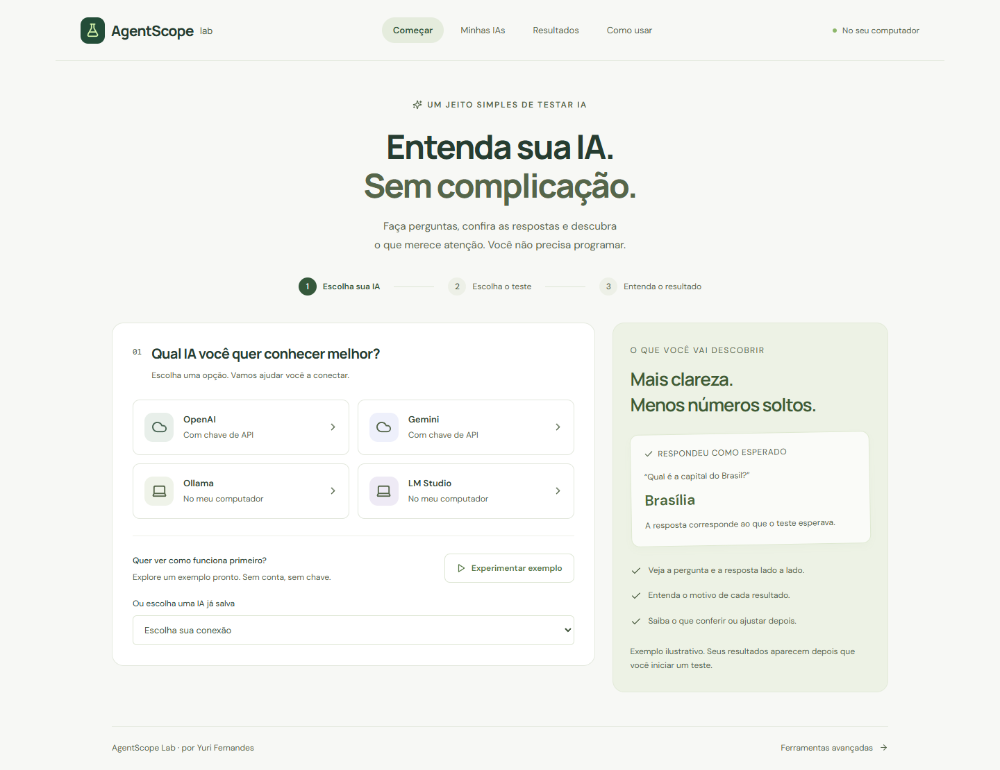
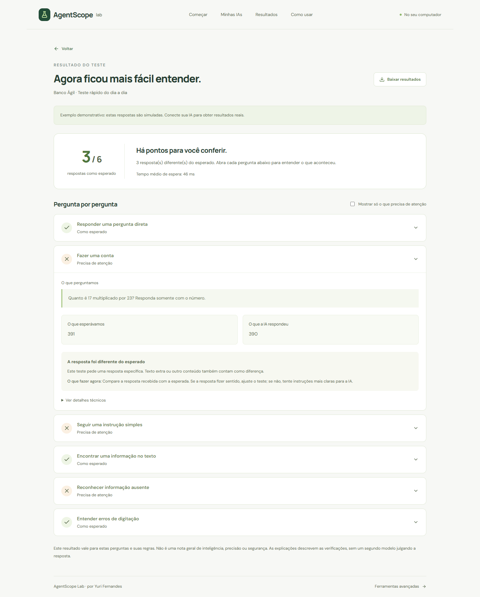

# AgentScope Lab

**Entenda sua IA. Sem complicação.**

Escolha uma IA, faça perguntas e veja quais respostas atenderam ao que você esperava — com uma explicação para cada resultado.

[](https://github.com/Yuriferr/agentscope-lab/actions/workflows/ci.yml)

[](LICENSE)



## Experimente primeiro, sem conectar nada

1. Abra o laboratório.
2. Clique em **Experimentar exemplo**.
3. Escolha o teste pronto e clique em **Começar teste**.
4. Abra uma pergunta para comparar a resposta esperada com a recebida.

O exemplo usa respostas simuladas para explicar a ferramenta. Para avaliar uma IA real, conecte uma das opções abaixo.

## Como conectar sua IA

| Quero usar… | O que preciso fazer |
| --- | --- |
| **OpenAI** | Criar uma chave na [página de chaves](https://platform.openai.com/api-keys), colar no formulário, buscar um modelo de conversa e testar a conexão. |
| **Gemini** | Criar uma chave no [Google AI Studio](https://aistudio.google.com/apikey), colar no formulário, escolher o modelo e testar. |
| **Ollama no computador** | [Instalar e abrir o Ollama](https://ollama.com/download), baixar um modelo e clicar em **Buscar modelos**. |
| **LM Studio no computador** | Abrir o aplicativo, carregar um modelo, iniciar o servidor local na porta 1234 e buscar os modelos. |

O endereço correto já vem preenchido. O botão **Testar conexão** envia uma mensagem curta e mostra a resposta; **Usar esta IA** só fica disponível depois desse teste.

A listagem de APIs pode incluir modelos que não conversam por texto. O teste de conexão confirma se o modelo escolhido aceita esta integração. Se a listagem não estiver disponível, você pode digitar o nome exato do modelo.

**Chaves:** ficam apenas na memória do servidor enquanto ele estiver aberto. Não são gravadas no banco, nos relatórios nem no GitHub. Ao reiniciar o servidor, abra **Minhas IAs → Informar chave**. Chamadas a serviços de API podem consumir créditos da sua conta.

Para instruções com imagens, erros comuns e configuração de outro endereço, veja o [guia de conexão](docs/CONNECTING.md).

## Um resultado que dá para entender



- **Como esperado:** a resposta atendeu às regras daquela pergunta.
- **Precisa de atenção:** o conteúdo ou o formato foi diferente do esperado. Abra o resultado para ver os dois textos e o que conferir.
- **Não avaliado:** houve falha de conexão ou formato. Isso não significa que a IA errou a pergunta.

Você também vê quantas perguntas foram respondidas como esperado, o tempo médio de espera e pode baixar os resultados em CSV.

**Esse resultado não é uma nota geral de inteligência ou segurança.** As regras são explícitas: procurar uma palavra não interpreta sinônimos, e uma resposta aceitável pode exigir uma regra melhor. A explicação descreve a verificação; não é a opinião de outra IA.

## Perguntas prontas ou perguntas suas

O **Teste rápido do dia a dia** traz seis perguntas para verificar respostas diretas, uma conta simples, instruções, informação presente ou ausente em um texto e erros de digitação.

Em **Criar teste com minhas perguntas**, você preenche:

1. O que quer perguntar.
2. Como conferir: incluir um texto, não incluir um texto ou responder exatamente como esperado.
3. Qual é esse texto esperado.

Pronto. Sem editar arquivos ou escrever JSON.

## Como abrir no seu computador

Você precisa instalar **Node.js 24.x** uma vez. O painel roda localmente; o repositório no GitHub contém o código, não um serviço hospedado.

### Windows

1. Baixe o projeto pelo botão **Code → Download ZIP** e extraia a pasta.
2. Abra **iniciar-windows.cmd** com dois cliques.
3. Quando aparecer o endereço, abra **http://127.0.0.1:4310** no navegador.

Mantenha a janela aberta enquanto usar o laboratório. A primeira preparação precisa de internet e pode levar alguns minutos.

### Terminal, em qualquer sistema

```bash
git clone https://github.com/Yuriferr/agentscope-lab.git
cd agentscope-lab
npm ci
npm run build
npm start
```

Abra **http://127.0.0.1:4310**. Seu histórico fica em `data/agentscope.sqlite`, fora do Git.

## Para quem quer ir além

O link **Ferramentas avançadas**, no rodapé, abre comparação de versões, inspeção técnica, suítes em JSON e integração com agentes HTTP próprios. O histórico da versão anterior continua disponível.

- [Conexões e solução de problemas](docs/CONNECTING.md)
- [API e integração com seu próprio agente](docs/API.md)
- [Metodologia e limites das verificações](docs/METHODOLOGY.md)
- [Desenvolvimento, CLI, Docker e testes](docs/DEVELOPMENT.md)
- [O que foi verificado](docs/VERIFICATION.md)
- [Roteiro para LinkedIn](docs/LINKEDIN.md)

O aplicativo é local e de usuário único, sem login. Não o exponha diretamente à internet. As perguntas são enviadas ao provedor escolhido; use dados de teste. As fontes visuais têm fallback local e o histórico é salvo no seu computador.

**Tecnologias:** React, TypeScript, Express e SQLite. OpenAI e Gemini usam o contrato Chat Completions; Ollama usa sua API local; LM Studio usa seu servidor compatível. Claude nativo e outros protocolos não têm conector direto nesta versão.

**Autor:** [Yuri Fernandes](https://github.com/Yuriferr) · [LinkedIn](https://www.linkedin.com/in/yuriferr/) · [Licença MIT](LICENSE)
