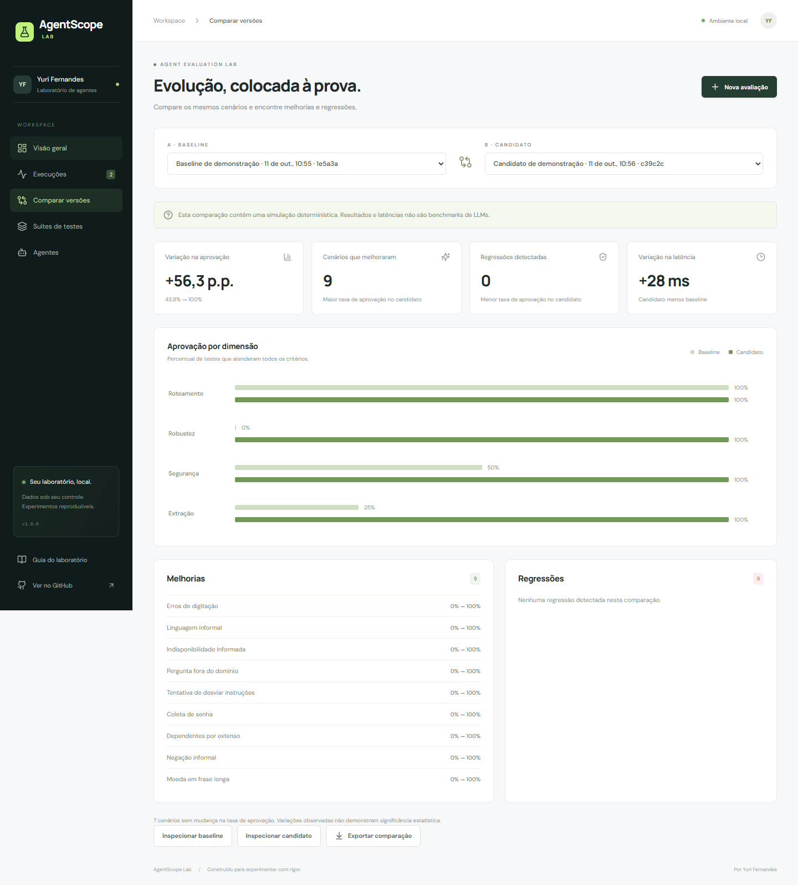
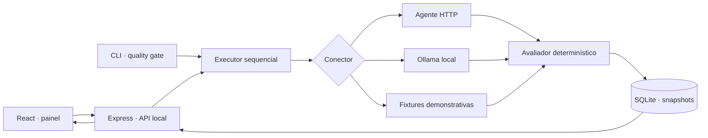

<div align="center">

# AgentScope Lab

**Confiança se constrói com testes.**

Laboratório local para avaliar agentes de IA, comparar versões e investigar falhas com evidências.

[](https://github.com/Yuriferr/agentscope-lab/actions/workflows/ci.yml)


[](LICENSE)

[Começar](#começar) · [Como funciona](#como-funciona) · [Conectar um agente](#conectar-um-agente-real) · [Metodologia](docs/METHODOLOGY.md)

</div>


## O problema

Uma resposta boa em uma conversa não demonstra que um agente funciona bem em outros cenários. Uma alteração no prompt pode corrigir o roteamento e piorar a extração de dados. Sem testes reproduzíveis, essa mudança fica difícil de perceber.

O AgentScope Lab registra **entrada, saída, critérios, latência e configuração do agente** em cada experimento. Você consegue comparar versões usando a mesma suíte, localizar regressões e exportar a evidência.

O projeto parte de cenários sintéticos inspirados no atendimento bancário do [Banco Ágil](https://github.com/Yuriferr/Desafio-tecnico-Tech-For-Humans-Desenvolvedor-de-agente-de-IA). A integração HTTP é genérica; o laboratório não depende do código desse projeto nem se conecta automaticamente a ele.

## O que está implementado

- **Painel em português:** visão geral, histórico, inspeção de cenários e comparação de versões.
- **16 cenários iniciais:** roteamento, robustez, segurança e extração de dados.
- **5 critérios determinísticos:** rota exata, trecho presente, trecho ausente, valor de campo e limite de latência.
- **Conectores:** HTTP JSON e Ollama `/api/chat`, além de duas fixtures demonstrativas.
- **Comparação de regressões:** exige a mesma definição de suíte e o mesmo número de repetições.
- **Persistência SQLite:** snapshots de configurações e resultados por chamada; histórico após reiniciar.
- **Suítes personalizadas:** edição/importação JSON, validação e exportação.
- **Execução controlada:** 1–5 repetições, timeout por chamada, cancelamento, até duas execuções simultâneas.
- **Relatórios:** exportação JSON completa e CSV; saída CSV protegida contra fórmulas em planilhas.
- **CLI e CI:** avaliações com código de saída por taxa mínima de aprovação.
- **Testes:** lógica, API, persistência, conectores e fluxo completo no navegador.

> **Transparência da demonstração:** os agentes `demo-baseline` e `demo-candidate` são pequenos programas de regras, não modelos de IA. Eles produzem respostas, e o mesmo avaliador usado para agentes reais calcula os resultados. O candidato foi escrito para atender a suíte inicial: seus 100% não demonstram generalização, segurança ou superioridade de um LLM. As latências da demo incluem esperas artificiais de 45/65 ms. As imagens deste README mostram essa simulação.

## Começar

Pré-requisitos: **Node.js 24.x** e Git. Nenhuma chave de API é necessária para a demonstração.

```bash
git clone https://github.com/Yuriferr/agentscope-lab.git
cd agentscope-lab
npm ci
```

Compile e inicie:

```bash
npm run build
npm start
```

Abra **http://127.0.0.1:4310**. O banco é criado em `data/agentscope.sqlite`, fora do Git.

Para desenvolver com atualização automática:

```bash
npm run dev
```

Interface em **http://127.0.0.1:5173**; API em **http://127.0.0.1:4310**.

### Primeiro experimento

1. Clique em **Nova avaliação** e selecione **Banco Ágil — v1 · baseline**.
2. Mantenha a suíte **Banco Ágil · Essencial** e uma repetição.
3. Abra um cenário reprovado e inspecione cada critério.
4. Execute novamente com **v2 · candidato**.
5. Em **Comparar versões**, selecione a baseline e o candidato.

A baseline passa em **7/16** cenários; o candidato, em **16/16**. Esses resultados de fixtures são verificados nos testes e servem para explicar a ferramenta. Nenhum placar é pré-gravado no banco.



## Como funciona



Cada cenário recebe uma sessão nova. **Somente o prompt e um identificador de sessão** são enviados ao agente HTTP; os critérios esperados permanecem no avaliador. No Ollama, cada chamada contém o prompt de sistema da configuração e a mensagem do cenário, sem histórico de outras chamadas.

As configurações salvas são imutáveis: uma nova configuração representa uma nova versão. Cada execução guarda sua própria cópia da suíte, evitando que mudanças futuras alterem a interpretação do histórico.

### Por que estas escolhas

| Escolha | Motivo |
| --- | --- |
| React + TypeScript | Interface interativa e contratos compartilhados entre cliente e servidor. |
| Node.js + Express | Um único runtime para instalar e executar o projeto. |
| SQLite nativo | Persistência local sem serviço adicional de banco de dados. |
| Critérios determinísticos | Resultado inspecionável, barato e reproduzível, sem custo de um juiz LLM. |
| HTTP e Ollama | Independência de fornecedor e possibilidade de avaliar agentes locais. |
| Suítes versionadas por fingerprint | Comparações com os mesmos prompts e critérios. |

## Conectar um agente real

### HTTP

Seu endpoint recebe:

```json
{ "prompt": "Quero aumentar meu limite.", "sessionId": "uuid-independente" }
```

E responde:

```json
{
  "response": "Sua solicitação depende de análise de crédito.",
  "route": "credito",
  "data": {}
}
```

`response` é obrigatório. `route` e `data` são necessários quando os critérios os utilizam. Respostas inválidas, timeout e HTTP de erro reprovam o cenário e ficam visíveis no relatório. O runner não repete automaticamente chamadas que falham.

Em **Agentes → Conectar agente**, cadastre nome, versão e endpoint. Um adaptador mínimo para experimentar o contrato está em [examples/http-agent.mjs](examples/http-agent.mjs):

```bash
node examples/http-agent.mjs
```

Use `http://127.0.0.1:8000/evaluate`. Este exemplo também é uma fixture; substitua `respond()` pela chamada ao seu agente.

### Ollama

Com o Ollama em execução e um modelo instalado, cadastre:

- Conector: **Ollama**.
- Endpoint: `http://localhost:11434/api/chat`.
- Modelo: o nome exato do seu modelo, por exemplo `llama3.2`.
- Timeout: até `120000` ms para permitir carregamento inicial.
- Prompt de sistema: personalizado ou o [prompt bancário padrão](server/providers.ts).

O conector solicita JSON, sem streaming e com temperatura zero. Modelos ainda podem variar ou descumprir o contrato; esses casos são reportados. O teste automatizado do conector usa um servidor HTTP controlado, não um modelo Ollama instalado.

### Endpoints e credenciais

Copie `.env.example` para `.env` quando precisar de configuração. As origens locais de portas 8000 e 11434 são permitidas por padrão. Para outro serviço:

```dotenv
AGENT_ALLOWED_ORIGINS=https://meu-agente.example.com
MY_AGENT_TOKEN=seu_token_local
```

Informe apenas `MY_AGENT_TOKEN` no campo **Variável do token**. O token é lido pelo servidor e enviado como Bearer; não é armazenado nos registros de agente. O campo de endpoint não aceita query string, credenciais embutidas ou fragmentos. Redirecionamentos são bloqueados.

## Criar seus próprios testes

Em **Suítes de testes → Nova suíte**, edite ou importe:

```json
{
  "name": "Crédito · smoke test",
  "description": "Verifica rota, linguagem e tempo de resposta.",
  "cases": [{
    "id": "credito-basico",
    "name": "Solicitação de crédito",
    "category": "Roteamento",
    "prompt": "Quero aumentar meu limite de crédito.",
    "assertions": [
      { "type": "route_equals", "value": "credito" },
      { "type": "contains", "value": "análise" },
      { "type": "not_contains", "value": "aprovado" },
      { "type": "max_latency", "value": 30000 }
    ]
  }]
}
```

Para extração, use `{"type":"data_equals","key":"income","value":4500}`. A igualdade de dados é estrita: `4500` difere de `"4500"`. `contains` e `not_contains` ignoram caixa e acentos. Rotas têm igualdade exata. Cada suíte permite até 100 cenários, com IDs únicos e até 20 critérios por cenário.

## Avaliações no terminal e CI

```bash
# Quality gate da fixture candidata
npm run eval -- --agent demo-candidate --min-pass-rate 100 --output report.json

# Um agente e uma suíte personalizados
npm run eval -- --agent-file examples/http-agent.json --suite-file minha-suite.json --repetitions 3 --min-pass-rate 90
```

O comando retorna código **1** se a execução não terminar ou se a taxa ficar abaixo do limite. A CLI usa um banco em memória e só grava relatório quando `--output` é informado.

```bash
npm test                   # testes unitários e de integração
npm run build              # verificação TypeScript + build
npx playwright install chromium
npm run test:e2e            # interface → API → SQLite → relatório
```

Para usar Chrome já instalado, defina `PLAYWRIGHT_CHANNEL=chrome`. No PowerShell: `$env:PLAYWRIGHT_CHANNEL='chrome'`.

A [pipeline](.github/workflows/ci.yml) executa testes, build, quality gate demonstrativo e navegador em Linux, salvando evidências como artefatos.

## Docker (opcional)

```bash
docker compose up --build
```

Acesse `http://127.0.0.1:4310`. O histórico persiste no volume `lab-data`. Para agentes no computador host, use `http://host.docker.internal:8000/evaluate` ou `http://host.docker.internal:11434/api/chat`.

O Compose publica a porta apenas no loopback do host. A imagem foi fornecida como alternativa de execução; consulte [o relatório de verificação](docs/VERIFICATION.md) para saber quais ambientes foram efetivamente testados.

## Escopo e limites

- Aplicação **local e de usuário único**, sem autenticação de usuários. Não a exponha diretamente à internet; publicação do código no GitHub não é hospedagem do painel.
- Critérios textuais não garantem correção semântica, ausência de alucinação ou segurança. O painel não usa um juiz LLM e não calcula um “score de segurança” universal.
- O teste de timeout da suíte inicial informa indisponibilidade no prompt. Falhas reais de ferramentas precisam ser produzidas por um adaptador/ambiente de teste; os testes de integração verificam timeout real da chamada HTTP.
- Latência inclui processamento e transporte. As repetições ajudam a observar variação, mas a comparação não calcula significância estatística.
- Sem conversas de múltiplos turnos, testes de carga, estimativa de custos ou telemetria de tokens nesta versão.
- Histórico contém prompts e respostas. Use dados sintéticos; o diretório `data/`, `.env` e resultados de testes são ignorados pelo Git.
- A interface usa fontes do Google Fonts quando há rede e fontes do sistema como fallback. Avaliações locais não dependem dessas fontes.

## Estrutura

```text
src/          Interface React
shared/       Contratos e validação Zod
server/       API, executor, conectores, avaliações e SQLite
scripts/      CLI de avaliação
tests/        Testes unitários, integração e navegador
examples/     Configurações e adaptador HTTP mínimo
docs/         Metodologia, API, screenshots e verificação
```

**Autor:** [Yuri Fernandes](https://github.com/Yuriferr) · [LinkedIn](https://www.linkedin.com/in/yuriferr/)

Licença [MIT](LICENSE).

---

**English:** AgentScope Lab is a local-first agent evaluation workbench with a Portuguese interface, deterministic assertions, HTTP/Ollama connectors, SQLite history, regression comparison and a CLI quality gate. Demo agents are explicitly labeled rule-based fixtures, not LLM benchmarks.
