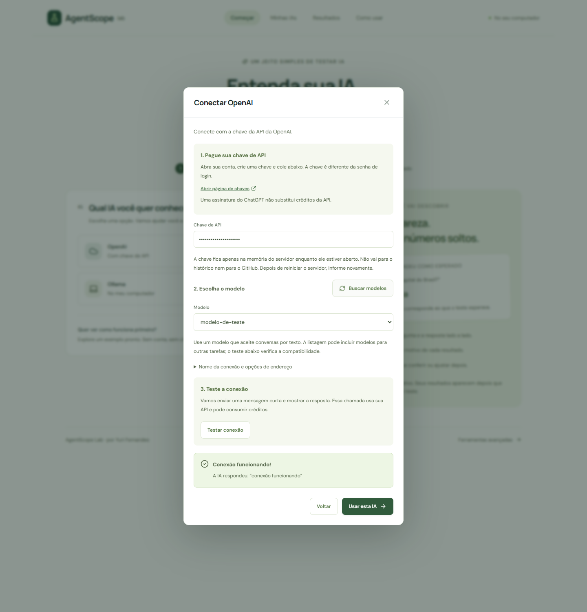

# Conecte uma IA, passo a passo

## OpenAI ou Gemini por API

1. Na página **Começar**, clique em **OpenAI** ou **Gemini**.
2. Use o link **Abrir página de chaves**. Crie uma chave na conta do provedor.
3. Cole em **Chave de API**. Não use a senha da conta.
4. Clique em **Buscar modelos** e escolha um modelo que aceite conversas por texto. Se necessário, digite o nome exato quando a listagem não estiver disponível.
5. Clique em **Testar conexão**. O laboratório envia uma mensagem curta; chamadas podem consumir créditos.
6. Quando aparecer **Conexão funcionando!**, clique em **Usar esta IA**.
7. Escolha o teste e clique em **Começar teste**.



A captura acima foi produzida com um servidor de teste, não com uma conta de API real. O formulário do seu provedor vem com o endereço oficial preenchido.

As chaves são temporárias: permanecem somente na memória do servidor. Após reiniciar, a conexão salva aparece como **Informe a chave novamente**. Clique em **Informar chave**; o laboratório testa antes de reconectar. O teste de conexão confirma acesso e formato, não a qualidade do modelo.

## Ollama no seu computador

1. [Instale o Ollama](https://ollama.com/download) e deixe o aplicativo aberto.
2. Baixe um modelo pela interface do Ollama ou pelo terminal. Exemplo: `ollama pull llama3.2`. Você pode escolher outro modelo compatível com conversas.
3. No laboratório, clique em **Ollama → Buscar modelos**.
4. Selecione o modelo instalado e clique em **Testar conexão**.
5. O primeiro carregamento pode demorar. O laboratório aguarda até dois minutos.
6. Clique em **Usar esta IA** e comece o teste.

O endereço padrão é `http://localhost:11434/api/chat`. Você não precisa configurar saída JSON: o modo simples avalia a resposta normal em texto. Instalar o aplicativo e baixar um modelo são etapas necessárias fora do laboratório.

## LM Studio no seu computador

1. [Instale e abra o LM Studio](https://lmstudio.ai/download).
2. Baixe e carregue um modelo que aceite conversas.
3. Na área de desenvolvedor do aplicativo, inicie o servidor local.
4. Confirme a porta **1234**. Se seu servidor exigir autenticação, informe a chave em **Nome da conexão e opções de endereço**.
5. No laboratório, clique em **LM Studio → Buscar modelos → Testar conexão → Usar esta IA**.

O endereço padrão é `http://localhost:1234/v1/chat/completions`.

## Erros comuns

| Mensagem / situação | O que fazer |
| --- | --- |
| A chave foi recusada | Confira se copiou a chave completa e se sua conta tem acesso ao modelo. |
| Limite de uso atingido | Confira créditos/limites no provedor ou aguarde antes de tentar novamente. |
| Não encontrei o Ollama | Abra o aplicativo e confirme que ele está funcionando na porta 11434. |
| Nenhum modelo encontrado | Baixe um modelo no Ollama ou carregue/inicie o servidor no LM Studio. |
| Modelo ou endereço não encontrado | Busque os modelos novamente e confira o endereço, incluindo o caminho completo. |
| A chamada demorou demais | O modelo pode estar carregando ou seu computador pode não ter recursos suficientes. Tente um modelo menor ou repita após o carregamento. |
| Preciso colocar a chave de novo | Isso é esperado após reiniciar o servidor: a chave não é salva no disco. |
| Endereço não permitido | Veja a configuração de endereços abaixo. Os quatro presets funcionam com suas origens padrão sem editar arquivos. |

## Outro computador, Docker ou outra API compatível

Em **Nome da conexão e opções de endereço**, você pode mudar o endereço e personalizar as instruções para a IA. Mudar a conexão exige um novo teste; mudar o endereço também limpa a chave do formulário.

As origens padrão são OpenAI, Gemini e `localhost`/`127.0.0.1` nas portas 8000, 11434 e 1234. Para uma origem diferente, acrescente-a no `.env` e reinicie o servidor:

```dotenv
AGENT_ALLOWED_ORIGINS=https://meu-provedor.example.com
```

Essa lista acrescenta origens às opções padrão. O endereço deve usar HTTP(S), não pode ter senha embutida, parâmetros de URL nem fragmento. Redirecionamentos são recusados.

No Docker, `localhost` é o próprio container. Para alcançar o computador, use `http://host.docker.internal:11434/api/chat` ou `http://host.docker.internal:1234/v1/chat/completions`. O Compose já autoriza essas origens. O servidor do modelo precisa aceitar conexões vindas do container.

Outras APIs que implementem **Chat Completions** podem usar o formulário OpenAI com endereço completo personalizado, terminado em `/chat/completions`. A descoberta espera um endpoint irmão `/models`. Essa compatibilidade depende do serviço; APIs com outro protocolo, como Claude nativo, precisam de um adaptador.

Para um agente HTTP próprio com contrato `{ prompt, sessionId } → { response, route, data }`, use **Ferramentas avançadas → Agentes** e siga a [documentação da API](API.md).

## Referências dos conectores

- [OpenAI: Chat Completions](https://developers.openai.com/api/reference/resources/chat)
- [Gemini: compatibilidade com OpenAI](https://ai.google.dev/gemini-api/docs/openai)
- [Ollama: listar modelos](https://docs.ollama.com/api/tags) e [conversas](https://docs.ollama.com/api/chat)
- [LM Studio: API compatível](https://lmstudio.ai/docs/developer/openai-compat)
