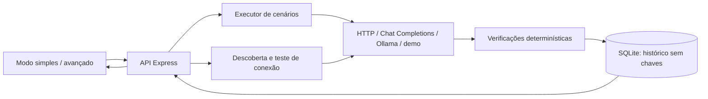

# Desenvolvimento e recursos avançados

Requisito: Node.js 24.x. Instale com `npm ci`.

```bash
npm run dev   # painel 5173, API 4310
npm run build # TypeScript e build
npm start     # API + build na porta 4310
npm test      # testes unitários e de integração
npx playwright install chromium
npm run test:e2e
```

No Windows com Chrome instalado: `$env:PLAYWRIGHT_CHANNEL='chrome'` antes do teste de navegador.

## CLI e quality gate

```bash
npm run eval -- --agent demo-candidate --min-pass-rate 100 --output report.json
npm run eval -- --agent-file examples/http-agent.json --suite-file minha-suite.json --repetitions 3 --min-pass-rate 90
```

No PowerShell, use `npm.cmd` no lugar de `npm` nesses comandos para preservar os argumentos após `--`.

A CLI continua usando a suíte bancária por padrão e aceita suítes exportadas por `--suite-file`. O processo retorna 1 quando a execução falha ou a taxa fica abaixo do mínimo. Chaves digitadas no painel não ficam disponíveis em outros processos: na CLI, configure `tokenEnv` e uma variável de ambiente local. Nunca coloque a chave dentro do JSON do agente.

## Docker

```bash
docker compose up --build
```

Painel em `http://127.0.0.1:4310`, persistência no volume `lab-data`. Credenciais de sessão somem ao reiniciar o container. O Compose publica a porta somente no loopback. Docker não foi executado no ambiente de desenvolvimento desta entrega.

## Arquitetura



`src/SimpleApp.tsx` contém o fluxo inicial; `src/ConnectForm.tsx` guia as conexões; `src/SimpleReport.tsx` traduz os critérios em explicações. A interface anterior está em `src/AdvancedApp.tsx`, carregada sob demanda pelo link `#advanced`.

`server/connections.ts` descobre modelos e testa acesso. `server/providers.ts` transforma os protocolos externos em uma resposta interna comum. `responseMode: plain` avalia texto normal; o modo estruturado continua disponível para a suíte bancária/integrações antigas.

Chaves recebidas no campo `apiKey` são separadas antes de persistir os agentes e guardadas em um Map na instância da aplicação. Os registros têm apenas `sessionKeyRequired`. Após reiniciar, a API expõe `needsKey`, e novas avaliações exigem reconectar.

As definições de suíte guardam prompts e verificações. O executor envia somente as entradas ao provedor. O histórico conserva snapshots, e as comparações exigem os mesmos critérios e repetições. Consulte [Metodologia](METHODOLOGY.md).
